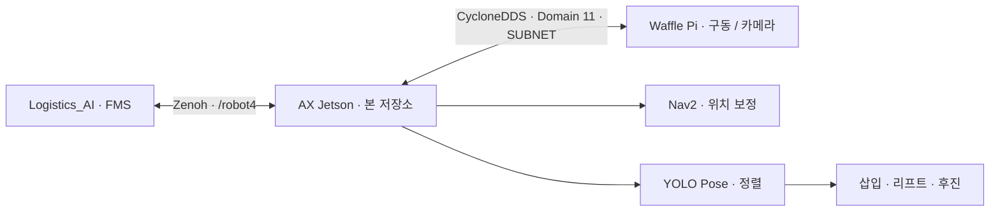

# Logistics_WAF

**LOGIFLOW · 비어 있는 팔레트를 회수하고 보충 팔레트를 제자리에 배치하는 Waffle 로봇**

재고 보충 로봇의 Jetson 측 작업공간이다. FMS가 보낸 목적지 번호를 받아 Nav2 이동, 팔레트 비전 정렬, 포크 삽입·리프트, 교체 후 복귀를 하나의 ROS 2 액션으로 수행한다. Waffle Pi의 구동부·카메라는 별도 장비에서 실행하고, 이 저장소는 주행·비전·작업 시퀀스를 담당한다.

[개요](#1-프로젝트-개요) · [기능](#2-주요-기능) · [연결](#3-시스템-연결) · [환경](#4-실행-환경) · [구조](#5-저장소-구조) · [설치](#6-설치-및-환경-설정) · [사용](#7-사용-방법) · [운영](#8-설정과-운영-시-참고) · [점검](#9-확인-및-점검) · [문서](#10-관련-문서와-저장소) · [브랜치](#11-브랜치와-문서-기준)

## 1. 프로젝트 개요

상차 로봇이 물품을 모두 사용하면 팔레트를 다시 채울 과정도 필요하다. WAF는 기존 팔레트를 회수하고 보충 팔레트를 원래 위치에 가져다 놓는 구간을 맡는다.

FMS는 작업을 요청하고 진행 상태를 받는다. 실제 경로 이동과 팔레트 정렬·운반은 WAF가 수행하며, 일반 배송용 AMR 3대와는 작업 방식이 다르다.

## 2. 주요 기능

- **목적지 이동:** 저장 지도와 keepout 마스크를 사용하는 Nav2 주행.
- **이동 전 위치 보정:** 정지 상태의 LiDAR 스캔을 지도와 비교해 AMCL 위치를 보정하고 이동을 준비한다.
- **팔레트 자세 추정:** YOLO Pose 8개 모서리와 카메라 보정값으로 팔레트 위치·방향을 추정한다.
- **정밀 정렬:** 관측 → 이동 → 정지 재관측을 반복하고, 조건을 만족하면 포크를 삽입한다.
- **팔레트 교체:** 첫 팔레트의 정렬 위치를 저장한 뒤 회수·반납·보충·제자리 배치를 연결한다.
- **외부 액션:** `/pallet_replace`로 요청을 받고 단계 피드백, 완료·실패·취소 결과를 전달한다.
- **카메라 요청 관리:** 정렬에 필요할 때 Pi의 `/camera/enable`을 호출한다.

현재 시퀀스는 **요청 목적지 인수 → 목적지 2 반납 → 목적지 3 보충 팔레트 인수 → 저장한 첫 위치에 배치 → 목적지 5 경유 → 목적지 4 복귀**다. 목적지의 의미와 좌표는 [nav2_send_goal.py](src/nav2_send_goal.py)의 `DESTINATIONS`가 기준이다.

## 3. 시스템 연결



| 장비 | 실행 역할 | 기본 작업공간 |
|---|---|---|
| Waffle Pi | Bringup, LiDAR·모터·리프트, 카메라 관리자 | `~/Logistics_WAF_RASPI`, `~/camera_ws` |
| AX Jetson | Nav2, 비전·팔레트 액션, Zenoh Bridge | `~/Logistics_WAF` |
| FMS PC | 수동 보충 요청, 단계·상태·결과 표시 | `~/AX_Logistics` |

**Pi와 Jetson 모두 Domain 11 / CycloneDDS / SUBNET이다.** Pi에서 Zenoh를 실행하지 않고 Jetson이 `/robot4` 네임스페이스로 FMS에 연결한다. 내부의 `/scan`, `/tf`, 카메라·Nav2·액션 이름에는 `/robot4`를 붙이지 않는다.

## 4. 실행 환경

| 항목 | 구성 |
|---|---|
| 운영체제·ROS | Ubuntu 24.04, ROS 2 Jazzy |
| 로봇 | TurtleBot3 Waffle, LDS-03, 포크·리프트 장치 |
| 비전 | Pi CSI 카메라(IMX219), 카메라 보정·장착 TF, YOLO Pose 체크포인트 |
| Python | 기존 동작 환경의 rclpy, OpenCV, NumPy, SciPy, Ultralytics 등 |
| 통신 | CycloneDDS, Jetson의 Zenoh ROS2DDS Bridge 1.9.0 |
| 필수 자료 | 지도·keepout 마스크, 팔레트 모델, 차체·포크 실측값과 현장 설정 |

모델 가중치와 Pi의 카메라 드라이버 빌드 결과는 이 저장소 clone만으로 준비되지 않는다. 비전 환경은 현장에서 동작 확인한 Python을 사용한다. 기존 예시 경로는 `~/venv/yolov3/bin/python`이다.

## 5. 저장소 구조

```text
Logistics_WAF/
├── src/pallet_replace_server.py   # FMS가 호출하는 교체 액션 서버
├── src/nav2_send_goal.py          # 목적지·위치 보정·운반 시퀀스
├── src/pallet_alignment_trial.py  # 정렬·삽입·리프트·배치
├── src/pallet_pose_detector.py    # 학습 모델 검출
├── src/pallet_pose_refinement.py  # 자세 재추정
├── src/waffle_interfaces/         # PalletReplace 액션 메시지
├── src/logitle_pose/              # 로봇 위치 발행
├── src/turtlebot3/                # Nav2·로봇 관련 ROS 패키지
├── config/                       # 주행·카메라·정렬 파라미터
├── map/                          # 지도와 keepout 마스크
├── scripts/                      # 카메라·데이터 수집·학습·평가 도구
├── calibration/ · datasets/      # 보정·데이터 준비 안내
└── tests/                        # 비전·정렬·시퀀스 검증
```

## 6. 설치 및 환경 설정

### Jetson 작업공간

ROS 2 Jazzy, rosdep, colcon이 준비된 새 장비 기준이다.

```bash
git clone --branch dev https://github.com/E1I6-Logistics/Logistics_WAF.git ~/Logistics_WAF
cd ~/Logistics_WAF
source /opt/ros/jazzy/setup.bash
rosdep install --from-paths src --ignore-src -r -y
colcon build --symlink-install --executor sequential
source install/setup.bash
```

비전 체크포인트를 별도로 준비하고 `config/trial.yaml`의 `pose_model`을 실제 경로와 맞춘다. 공유 설정에 남아 있는 개발 PC의 절대 경로는 새 장비의 파일 존재를 보장하지 않는다. 카메라 보정, 지도와 마스크, `config/waffle_real_nav.yaml`도 현장 구성을 확인한다.

### 통신·단축 명령 등록

[shellscript](https://github.com/E1I6-Logistics/shellscript/tree/dev)를 받은 뒤 **각 장비의 역할에 맞는 명령 하나**를 실행한다.

| 장비 | 등록 명령 |
|---|---|
| Waffle Pi | `bash scripts/waffle/install.sh --role pi` |
| AX Jetson | `bash scripts/waffle/install.sh --role jetson` |

등록 후 `source ~/.bashrc`, `robot_info`로 확인한다. 호스트명이 `localhost.localdomain`인 Jetson도 역할을 명시해 등록할 수 있다. Pi 구동부 설치는 [Logistics_WAF_RASPI](https://github.com/E1I6-Logistics/Logistics_WAF_RASPI), 카메라는 [카메라 안내](README_CAMERA.md)를 참고한다.

## 7. 사용 방법

### 수동 실행

단축 명령이 등록된 상태에서 각 프로그램을 **별도 터미널**로 실행한다. systemd 서비스가 이미 실행 중이면 중복 실행하지 않는다.

| 장비 | 명령 | 역할 |
|---|---|---|
| Waffle Pi | `wafbring` | 로봇 구동부 |
| Waffle Pi | `wafcamera` | 카메라 관리자 |
| AX Jetson | `wafnav2` | 지도·keepout을 사용하는 Nav2 |
| AX Jetson | `wafreplace` | 팔레트 비전·액션 서버 |
| AX Jetson | `logizenoh <FMS_PC_IP>` | FMS 연결 |

직접 실행할 경우 Jetson의 Nav2 명령은 다음과 같다.

```bash
source /opt/ros/jazzy/setup.bash
source ~/Logistics_WAF/install/setup.bash
export TURTLEBOT3_MODEL=waffle ROS_DOMAIN_ID=11
export RMW_IMPLEMENTATION=rmw_cyclonedds_cpp
export ROS_AUTOMATIC_DISCOVERY_RANGE=SUBNET
unset ROS_LOCALHOST_ONLY
ros2 launch turtlebot3_navigation2 navigation2.launch.py \
  use_sim_time:=false \
  map:="$HOME/Logistics_WAF/map/logitle_map_fin.yaml" \
  mask:="$HOME/Logistics_WAF/map/logitle_map_fin_keepout.yaml" \
  params_file:="$HOME/Logistics_WAF/config/waffle_real_nav.yaml"
```

별도 터미널에서 같은 ROS 환경을 읽고 액션 서버를 실행한다.

```bash
source ~/shellscript/logitlebash.sh
wafreplace
```

### 작업 요청과 피드백

FMS의 품목별 **재고 보충** 버튼을 사용하거나 Domain 11의 터미널에서 직접 요청한다. 다음 명령은 실제 교체 동작을 시작한다.

```bash
ros2 action send_goal /pallet_replace \
  waffle_interfaces/action/PalletReplace '{destination: 1}' --feedback
```

Goal은 `int32 destination`, Result는 `bool success`·`string message`, Feedback은 `string stage`다. `NAV_TO_PICK`, `ALIGN`, `NAV_TO_DROP`, `NAV_TO_PICK_2`, `ALIGN_2`, `NAV_TO_PLACE`, `PLACE`, `NAV_TO_VIA`, `NAV_TO_HOME` 등 현재 단계를 전달한다.

FMS의 A=1/B=2/C=3/D=4는 **첫 인수 목적지 매핑**이다. 뒤의 반납·보충·복귀 목적지가 품목마다 자동으로 바뀌는 의미는 아니다.

### 부팅 자동 시작

역할 등록과 수동 실행 확인을 마친 뒤 Pi·Jetson 각각에서 등록한다.

```bash
sudo loginctl enable-linger "$(id -un)"
waf_service autostart
```

`waf_service status`, `waf_service logs --follow`로 확인한다. 정지·시작·재시작은 각각 `waf_service stop`, `start`, `restart`다. 자동 시작은 서비스를 준비하고 goal을 기다리며 보충 작업을 자동 전송하지 않는다.

## 8. 설정과 운영 시 참고

- **초기 위치:** 저장 지도와 AMCL 추정이 맞는 범위에서 시작한다. 지도·스캔·TF가 없는 상태를 위치 추정 완료로 취급하지 않는다.
- **카메라:** 관리자는 준비 상태로 대기하고 정렬 요청 때 카메라를 켠다. 영상·카메라 보정·TF가 함께 맞아야 한다.
- **비전 모델:** 현재 검출기는 팔레트 1개 클래스와 정해진 8점 순서를 확인한다. 다른 모델은 경로만 바꿔 호환된다고 가정할 수 없다.
- **파라미터:** 팔레트 치수·포크 돌출·차체 앞면·ROI·정렬 허용값은 설치 환경의 측정값이다. 다른 장비에 그대로 적용하지 않는다.
- **취소:** 액션 취소 접수와 실제 작업 종료는 구분한다. FMS는 종료 Result/Status를 확인한 뒤 새 요청을 허용한다.
- **완료 결과:** `success`는 서버 시퀀스의 결과이며 팔레트 안 물품 수를 측정한 값이 아니다.

## 9. 확인 및 점검

Jetson의 Domain 11 터미널에서 다음을 조회한다.

```bash
ros2 action info /pallet_replace
ros2 lifecycle get /bt_navigator
ros2 service list | rg camera/enable
ros2 topic list
```

FMS에서는 `ros2 action info /robot4/pallet_replace`를 조회한다. 내부와 외부 액션 이름의 차이를 구분한다. 카메라 관리자가 대기 중이면 실제 카메라 영상이 상시 발행되지 않을 수 있다.

| 증상 | 확인 위치 |
|---|---|
| 초기 `odom`·TF 대기 | Pi Bringup 완료, Domain·RMW, 센서와 TF 수신 |
| 팔레트 서버 시작 실패 | Python 환경, `pose_model`, 정렬 설정 검증 메시지 |
| FMS에서 robot4가 보이지 않음 | Jetson Bridge, FMS IP, 허용 목록, Router |
| 영상·검출 없음 | 카메라 관리자, `/camera/enable`, 이미지 토픽·보정값 |
| 정렬·삽입 중단 | 단계 피드백, odom·scan·토크·후방 영역과 설정 |

`tests/`의 계산 검증과 실제 포크·리프트 동작 검증은 구분한다. 이번 README·브랜치 정리는 실기체를 재가동하거나 성능을 다시 측정한 작업이 아니다.

## 10. 관련 문서와 저장소

- [Nav2·지도·위치 보정](README_AUTONOMOUS.md)
- [Pi 카메라와 Jetson 영상 연결](README_CAMERA.md)
- [카메라 보정 기록](calibration/README.md)
- [모델 적용](README_PALLET_MODEL.md) · [정렬·삽입·교체 시험](README_PALLET_TRIAL.md)
- [정렬 구조](README_PALLET_ALIGNMENT.md) · [관찰 화면](README_PALLET_PREVIEW.md)
- [FMS: Logistics_AI](https://github.com/E1I6-Logistics/Logistics_AI/tree/dev)
- [환경·자동 시작: shellscript](https://github.com/E1I6-Logistics/shellscript/tree/dev)
- [Waffle Pi 구동부: Logistics_WAF_RASPI](https://github.com/E1I6-Logistics/Logistics_WAF_RASPI)

기존 세부 문서는 각 시험 시점의 기록을 포함한다. 현재 전체 장비 구성은 이 README의 Pi/Jetson 역할과 통신 구성을 기준으로 읽는다.

## 11. 브랜치와 문서 기준

2026-11-07 정리 기준은 최근 사용한 원격 `sso_dev`의 `1a46aff`다. 해당 실행 코드를 유지하고 프로젝트 README를 추가한 `dev`를 최종 검토용으로 사용한다. **`main` 반영은 최종 검토·이미지 추가 후 별도로 진행한다.**

이번 정리에서 실행 코드·모델·지도·파라미터·설치 스크립트는 수정하지 않는다. 자동 시작 서비스의 구현은 연결 저장소 `shellscript`에 있다.
